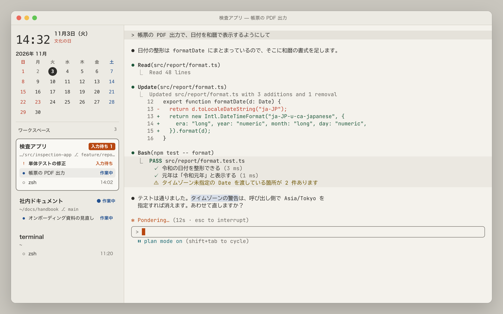

# Kinari（生成り）

長時間作業しても読みやすいことを目標にした、[cmux](https://github.com/manaflow-ai/cmux) / Ghostty 用の明るいターミナルテーマと、時計・カレンダー付きのサイドバーです。

配色は、背景色と文字色の見やすさに関する国内の研究をもとに決め、コントラスト比と色覚の違いを想定した色差を計算で確かめています。



<sub>画面は架空のデータで作ったモックです（`docs/mock/screen.html`。`docs/mock/render.sh` で書き出し）。</sub>

| ファイル | 内容 |
|---|---|
| `theme/Kinari` | ターミナルテーマ（Ghostty 形式） |
| `sidebar/kinari.js` | cmux のサイドバー。時計・月カレンダー（祝日つき）・ワークスペースごとのセッション一覧 |
| `scripts/update-holidays.py` | 内閣府の祝日 CSV から、サイドバーの祝日表を更新する |
| `launchd/kinari-holidays.plist.template` | 祝日更新を毎月自動で実行するための launchd 設定の雛形 |
| `ghostty/fonts.snippet` | 任意：JetBrains Mono と BIZ UDGothic を組み合わせるフォント設定 |
| `tools/check-palette.py` | テーマの配色を検証する（コントラスト比・色差） |

## 配色の考え方

| 方針 | 根拠 | Kinari での値 |
|---|---|---|
| 明るい背景に暗い文字にする | 黒背景では、コントラストが下がったときに読む速さ・注視時間の個人差が大きい［1］ | 背景 `#f4f2ec`、本文 `#2f2e2b` |
| コントラストは高く、ただし上げすぎない | 真っ白に真っ黒は強すぎて負担になり、かえって見づらいと感じる人がいる［1］［2］。［1］は白背景に `#333333` を使っている | 本文 12.1:1。背景は真っ白ではない生成り色（L*≈95） |
| 色味だけに頼らない | 年齢が上がるほど、見分けは色味より明るさの差に頼るようになる［1］ | 見分けたい色同士（赤と緑、青と紫など）は明るさもずらす。1型・2型色覚の模擬でも差が残るよう調整 |
| 文字に使う色は十分な濃さにする | 輝度コントラストが下がると黙読時間・注視時間が延びる［1］ | 文字に使う色は、どれも背景に対して 4.4:1 以上 |
| 目立つ色は大事なところだけに使う | 赤・黄赤は目を引きやすく、緑・青緑・青紫は目を引きにくい［3］ | 朱はエラー・注意・カーソル、サイドバーの「入力待ち」だけ |
| 読みにくい組み合わせを避ける | 白に淡い黄、青と緑、紫と濃い青などは読みにくい［4］ | 黄色は黄土色まで暗くして使う |
| 行間を詰めすぎない | 行間・余白も読みやすさに関わる［1］ | 行の高さを 15% 広げる（`adjust-cell-height`） |

### パレット

| 番号 | 色 | 用途（Claude Code の ANSI モード） | 対背景 |
|---|---|---|---|
| 0 | `#2f2e2b` | 本文 | 12.13:1 |
| 1 | `#bc3b28` | 削除・失敗 | 4.94:1 |
| 2 | `#1d573a` | 追加・成功 | 7.57:1 |
| 3 | `#6d5400` | 警告 | 6.43:1 |
| 4 | `#22508f` | 許可・候補 | 7.18:1 |
| 5 | `#a0478c` | スキル | 4.97:1 |
| 6 | `#1b6a73` | 計画モード | 5.59:1 |
| 7 | `#e5e2da` | 自分の発言の背景 | （背景用） |
| 8 | `#696660` | 薄い文字 | 5.11:1 |
| 9 | `#b84711` | Claude の色 | 4.75:1 |
| 10〜14 | | 0〜6 の明るい版 | 4.53〜5.73:1 |
| 15 | `#ebe8e1` | コマンド出力の背景 | （背景用） |

数値は `python3 tools/check-palette.py` で再計算できます。

## サイドバー

- **時計と日付**：曜日と、祝日なら祝日名を表示します。
- **月カレンダー**：日曜・祝日は赤、土曜は青。今日は色ではなく、暗い丸に白抜きの数字で示します。
- **ワークスペース**：ワークスペースごとに、フォルダ・ブランチ・未コミットの有無と、中のセッションを表示します。cmux のグループを使っていれば、グループの見出しの下にまとめます。
- **セッションの状態**：色に加えて記号と言葉でも区別します。`!` 入力待ち（朱の帯）、`●` 作業中、`○` 待機中。
- クリックしたワークスペース・セッションへすぐ移動します。

`sidebar/kinari.js` の先頭の `DEMO` を `true` にすると、架空のデータで表示を確認できます。

## 導入

```sh
# テーマ
mkdir -p ~/.config/ghostty/themes
cp theme/Kinari ~/.config/ghostty/themes/
cmux themes set "Kinari"

# サイドバー
mkdir -p ~/.config/cmux/sidebars
cp sidebar/kinari.js ~/.config/cmux/sidebars/
cmux sidebar select kinari
```

前のテーマの背景画像が残る場合は、cmux を一度終了して起動し直してください。

Claude Code では `/theme` から **Light mode (ANSI colors only)** を選びます。Claude Code のすべての色が、このテーマのパレットから取られるようになります。

### 祝日の自動更新（任意）

サイドバーの JavaScript からはネットワークにアクセスできません。そのため祝日表は、外部のスクリプトで `sidebar/kinari.js` を書き換えて更新します。内閣府は翌年分まで公表するので、毎月 1 日の 9 時とログイン時に取得し直します。

```sh
mkdir -p ~/.config/cmux/scripts
cp scripts/update-holidays.py ~/.config/cmux/scripts/
sed "s#__HOME__#$HOME#g" launchd/kinari-holidays.plist.template \
  > ~/Library/LaunchAgents/io.github.shimajiro4892.kinari-holidays.plist
launchctl bootstrap gui/$(id -u) ~/Library/LaunchAgents/io.github.shimajiro4892.kinari-holidays.plist
```

- 書き換えるのは `// HOLIDAYS:BEGIN` から `// HOLIDAYS:END` の間だけです。中身が変わらなければ何もしません。
- 書き換えたあと `cmux sidebar validate` が通らなければ元に戻します。取得に失敗したときは、ファイルに触れません。
- ログは `~/Library/Logs/kinari-holidays.log` に残ります。

自動更新をやめるときは、次を実行します。

```sh
launchctl bootout gui/$(id -u)/io.github.shimajiro4892.kinari-holidays
rm ~/Library/LaunchAgents/io.github.shimajiro4892.kinari-holidays.plist
```

### フォント（任意）

`ghostty/fonts.snippet` を `~/.config/ghostty/config` に追記すると、英数字が JetBrains Mono、日本語が BIZ UDGothic になります。cmux は日本語に独自のフォールバックフォントを差し込むので、それを避けるための `font-codepoint-map` も入れてあります。

## 既知の制限

- 1型色覚の模擬では、3（黄土・警告）と 9（朱・Claude の色）の差が小さくなります（ΔE≈3.8）。この2色が隣り合う場面は少ないので、明るさの差（ΔL*≈8）で見分ける前提にしています。
- 黒背景を好む人や、暗い部屋で使う場合には向きません。ダーク版は用意していません。
- 確認した環境は cmux 0.65.2、macOS 27 です。

## 参考文献

1. 齋藤大輔「背景色と文字色の組み合わせによる見やすさの関係」日本色彩学会誌 45(4), pp.162–167, 2021.
2. 平松明希子・山口俊光・納富一宏・斎藤恵一・斎藤正男「Web 利用時の背景色と文字色の視認性に関する基礎的検討（第一報）―無彩色の場合―」FIT2002 情報科学技術フォーラム, H-2, 2002.
3. 神作博「画面構成法による環境内の色彩の誘目性に関する研究」日本眼科学会雑誌 91, pp.879–889, 1987.
4. 「遠くからでもよく見える！目立つ色の組み合わせについて解説」のれんキング（株式会社イタミアート）https://www.i-noren.com/column/striking_color_combination
5. Machado, G. M., Oliveira, M. M., Fernandes, L. A. F. "A Physiologically-based Model for Simulation of Color Vision Deficiency." IEEE TVCG 15(6), 2009.（色覚の模擬に使用）
6. 内閣府「国民の祝日について」https://www8.cao.go.jp/chosei/shukujitsu/gaiyou.html（祝日データの取得元）
